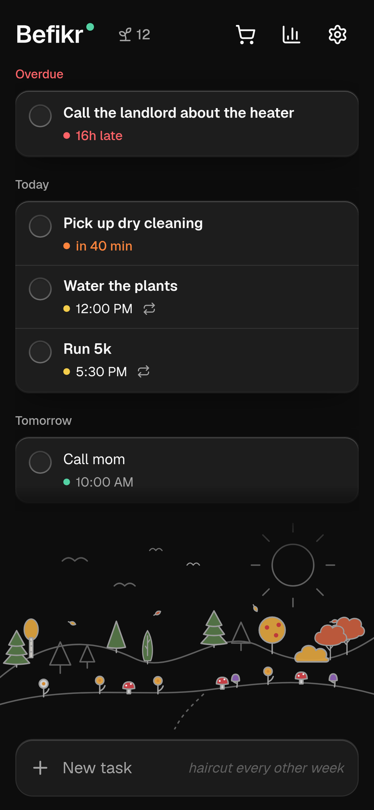
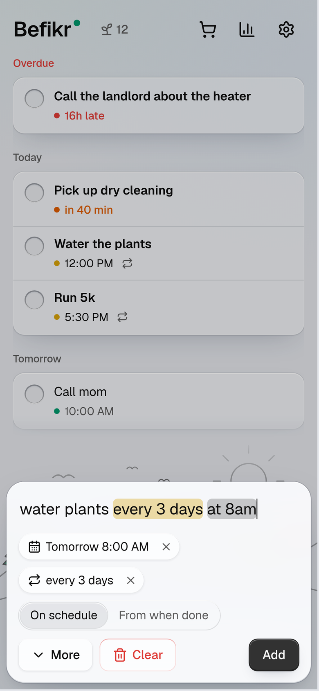
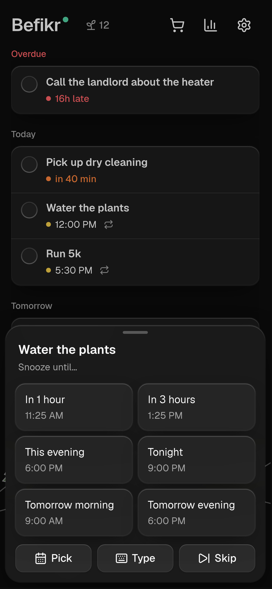
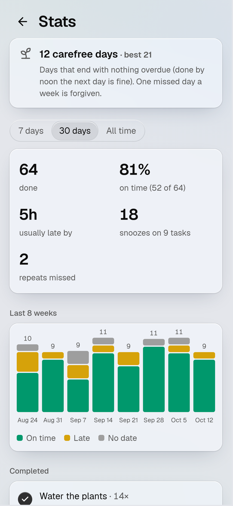
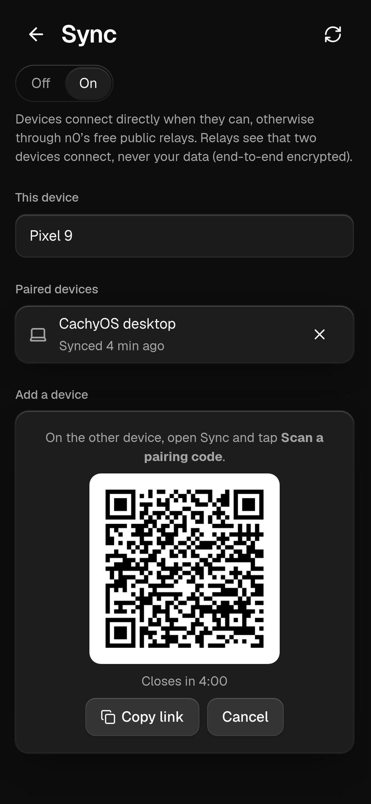
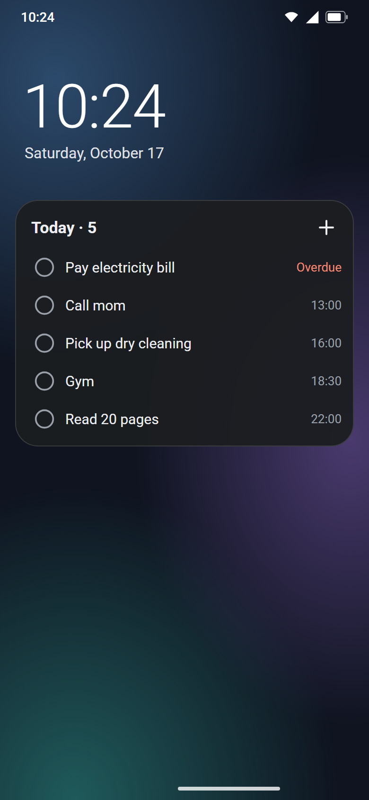
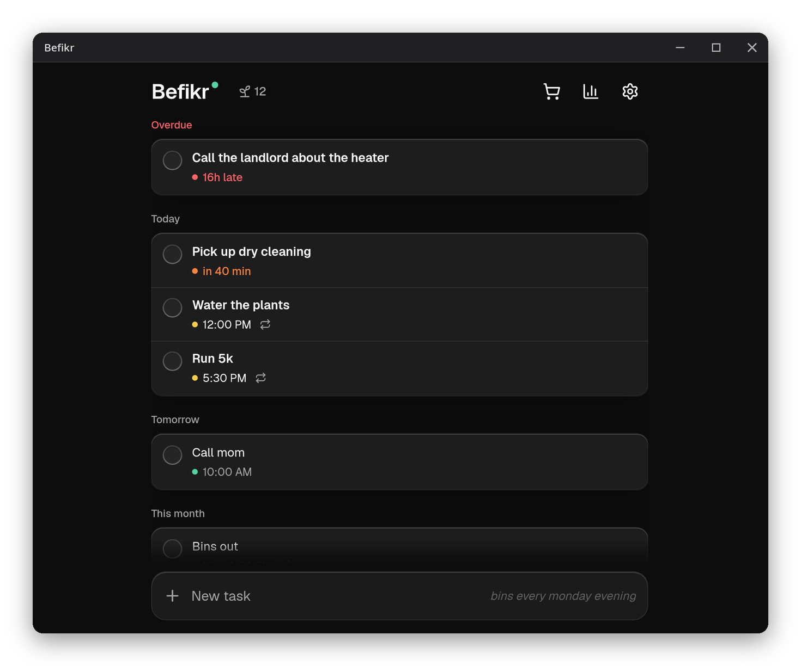

<p align="center">
  
</p>

<h1 align="center">Befikr</h1>

<p align="center">
  <b>A private to-do list that reminds you, reliably.</b><br>
  Type a task in plain English, get a reminder on your phone that actually rings.<br>
  No account, no server, no cloud: your tasks stay on your devices.
</p>

<p align="center">
  <a href="https://github.com/oowais/befikr/releases/latest"></a>
  
  <a href="LICENSE"></a>
</p>

---

*Befikr* means "carefree": a to-do list for people who want their reminders to work and their tasks to stay private. Write `call mom fri 5pm` or `water plants every 3 days`. Befikr works out the date, the time and the repeat, then reminds you on time, again and again until you deal with it.

<table align="center">
  <tr>
    <td align="center" width="270"></td>
    <td align="center" width="270"></td>
    <td align="center" width="270"></td>
  </tr>
  <tr>
    <td align="center"><sub><b>Your day at a glance</b><br>The garden grows as you keep up</sub></td>
    <td align="center"><sub><b>Just type it</b><br>Dates and repeats picked out as you write</sub></td>
    <td align="center"><sub><b>Snooze in one tap</b><br>Also straight from the notification</sub></td>
  </tr>
</table>

<table align="center">
  <tr>
    <td align="center" width="270"></td>
    <td align="center" width="270"></td>
    <td align="center" width="270"></td>
  </tr>
  <tr>
    <td align="center"><sub><b>See how you're doing</b><br>On time, late, snoozed</sub></td>
    <td align="center"><sub><b>Sync your devices</b><br>Pair with a QR code, no server</sub></td>
    <td align="center"><sub><b>Today on your home screen</b><br>Tick tasks off without opening the app</sub></td>
  </tr>
</table>

## Features

- **Plain-English quick add.** "dentist fri 3pm", "rent every month on the 1st", "standup every weekday 9am", "stretch in 2 hours". Highlighted as you type; tap a highlight to keep those words as plain text.
- **Reminders you can trust.** Exact alarms on Android, reminders that stay until you act (swiped away, they come back an hour later), and they survive reboots.
- **Act from the notification.** Complete, Snooze or Skip without opening the app. Snooze shows a small sheet over whatever you're doing.
- **Today at a glance.** A home-screen widget with today's tasks to tick off, and a morning digest notification (time of your choice, or off).
- **Repeating tasks done right.** Static (stays on its dates) or adaptive (counted from when you finish); skip one occurrence; habit streaks and a full history by month.
- **Peer-to-peer sync.** Pair your phone and computer with a QR code. Devices talk directly, end-to-end encrypted, also in the background.
- **Backups.** Daily copy to a folder you choose (keeps the last 7), export and restore any time.
- **Small extras.** Subtasks, notes, a shopping list with your usual items, suggestions from past tasks, "Share → Befikr" from any app, stats, a carefree-days streak and a garden that grows with it. Light and dark.

## Three platforms, one list

| Platform | Get it | Updates |
| --- | --- | --- |
| **Android** 8+ | [`befikr.apk`](https://github.com/oowais/befikr/releases/latest/download/befikr.apk), or track the repo in Discoverium | In the app (Settings), or Discoverium |
| **Windows** 10/11 | `befikr_x.y.z_x64-setup.exe` from the [latest release](https://github.com/oowais/befikr/releases/latest) | In the app (signed updates) |
| **Linux** | `.deb` from the [latest release](https://github.com/oowais/befikr/releases/latest). Arch / CachyOS: [`scripts/install-arch.sh`](scripts/install-arch.sh) builds and installs a pacman package | Your package manager (Arch: run the script again) |

All three run the same app with the same Rust core, and sync with each other. On computers Befikr lives in the tray, can start with the system (hidden), and shows native notifications with Complete and Snooze.

<p align="center">
  
</p>

## Privacy

- Your tasks live in a SQLite database on each device. There is no Befikr server and no account.
- Sync goes device to device, encrypted end to end ([iroh](https://www.iroh.computer/)). When two devices can't reach each other directly, a public relay passes the encrypted traffic along: it sees that two devices talk, never what they say.
- No analytics, no tracking. The only other request is a daily check of GitHub for a newer release.

## Build from source

Tauri 2 · Nuxt (SPA) · Rust core (`crates/core`, SQLite via rusqlite) · TypeScript parser (`packages/parser`) · Kotlin for Android alarms and notifications.

```bash
pnpm install
pnpm tauri dev                    # desktop app with hot reload
pnpm tauri build --bundles nsis   # Windows installer
pnpm tauri build --bundles deb    # Linux .deb
pnpm test                         # parser tests
cargo test --workspace            # core, sync and app tests
```

Installers land in `target/release/bundle/`. Linux needs `webkit2gtk-4.1`, `gtk3` and `librsvg`. The Android APK needs the Android SDK and NDK and is built by CI: [`.github/workflows/android.yml`](.github/workflows/android.yml) has every step, from `pnpm tauri android init` to signing. Design notes and status: [`PLAN.md`](PLAN.md).

## License

[GPL-3.0-or-later](LICENSE). The Glass design system is adapted from [Solid Glass](https://github.com/deeplethe/solid-glass) (MIT).
